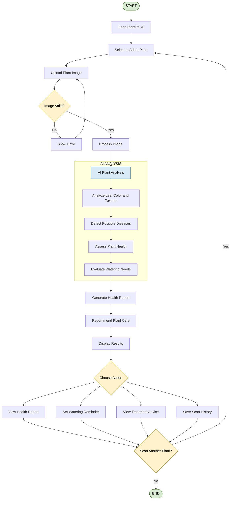

# 🌱 PlantPal AI

**PlantPal AI** is an AI-powered smart plant care assistant that helps users monitor plant health using Computer Vision and Artificial Intelligence. By scanning plant images, the app can detect watering needs, overwatering, diseases, unhealthy leaves, and provide personalized plant care recommendations.

The platform is designed to make plant care simple, intelligent, and interactive through a beautiful modern user experience.

link : https://plant-pal-ai-eta.vercel.app/
---
## ACTIVITY FLOWCHART OF PLANTPAL AI



    ## ✨ Features

- 📷 AI-powered plant scanning
- 🌿 Plant health analysis
- 💧 Smart watering recommendations
- 🚨 Overwatering & underwatering detection
- 🍂 Leaf disease detection
- 🧠 AI-generated care suggestions
- 🔔 Smart reminders & notifications
- 📊 Plant health dashboard
- 🌙 Dark mode support
- ⚡ Smooth Apple-inspired UI

---

## 💡 How It Works

1. User uploads or scans a plant image
2. AI analyzes leaves, color, and plant condition

3. System detects:
   - Water needs
   - Diseases
   - Health issues
   - Nutrient deficiencies
4. App generates smart care suggestions and reminders

### Example
> “Your Monstera is slightly dehydrated. Water within 5 hours.”

---

## 🤖 Technologies Used

### Frontend
- React.js
- Tailwind CSS
- Framer Motion

### Backend
- Node.js / Flask

### AI & Computer Vision
- Python
- TensorFlow
- OpenCV
- YOLO / CNN Models

### Database
- MongoDB / MySQL

---

## 🗃️ Database Modules

- Users
- Plants
- Scan History
- Water Logs
- Health Reports
- Disease Detection
- Notifications
- Treatment Suggestions

---

## 📁 Project Structure

```bash
PlantPal-AI/
├── frontend/
├── backend/
├── ai-model/
├── database/
└── README.md
```

---

## 🚀 Installation

```bash
# Clone repository
git clone https://github.com/your-username/PlantPal-AI.git

# Open project folder
cd PlantPal-AI

# Install dependencies
npm install

# Start frontend
npm start

# Start backend
node server.js
```

---

## 🌿 AI Features

- Plant species recognition
- Disease detection from leaves
- Water level prediction
- Smart care recommendations
- Health percentage analysis

---

## 🎨 UI Inspiration

PlantPal AI follows a:
- Minimal Apple-inspired design
- Nature-focused aesthetic
- Glassmorphism UI
- Smooth transitions and animations
- Green gradients and calming colors

---

## 📌 Future Improvements

- 🌤️ Weather-based watering suggestions
- 📈 Plant growth tracking
- 🎤 Voice assistant for plant care
- 📷 Live camera scanning
- ☁️ Cloud sync
- 🌍 Plant community sharing

---

## 🎯 Project Objective

The goal of PlantPal AI is to help users care for plants intelligently using AI-driven analysis, real-time recommendations, and computer vision technology.

---


## 🤝 Contributing

Contributions are welcome! Feel free to fork this project and improve it.

---

## 📄 License

This project is licensed under the MIT License.

---

## 💬 Final Note

PlantPal AI makes plant care smarter, easier, and more interactive.

**Scan. Analyze. Grow. 🌱✨**
